<p align="center">
  
</p>

<h1 align="center">Sharp Sharp</h1>
<p align="center"><b>Real slang. Real South Africa.</b></p>

<p align="center">
  
  
  
  
</p>

Sharp Sharp is a mobile app that teaches the real, spoken slang, idioms, and everyday phrases of South Africa's local languages, the version people actually speak, not the textbook one. Users swipe through a live feed of slang terms submitted by other users, save the ones they want to learn, and contribute words of their own.

Built for Interactive Development 300 at Open Window.

<p align="center">
  
  
  
</p>

These three attributes shape everything about how the app works:

- **Learn Something** — the entire app is built around teaching real, community-sourced slang that doesn't exist in a textbook.
- **Real-Time Data** — the term feed updates live via Firestore listeners as other users add and flag content; nothing is static.
- **Landscape Support** — saved terms can be studied in a dedicated landscape flashcard mode, built specifically to use the phone sideways as a real interaction, not a fallback.

---

## Contents

- [Demonstration video](#demonstration-video)
- [Platform](#platform)
- [How it works](#how-it-works)
- [Future iterations](#future-iterations)
- [Tech stack](#tech-stack)
- [Getting started](#getting-started)
- [Test credentials](#test-credentials)
- [Project structure](#project-structure)
- [Data sources](#data-sources)

---

## Demonstration video

**[Watch the full walkthrough on Google Drive](https://drive.google.com/drive/folders/1rM9hthB09ExNsGo49vPFtPxBbVTAqaVC?usp=sharing)**

---

## Platform

Sharp Sharp is a cross-platform mobile app built entirely in **React Native**, interfacing with **Google Firebase** as its backend service (Authentication and Firestore). It is built with Expo, which compiles a single codebase for deployment on both **Android and iOS**, satisfying the assignment's cross-platform requirement without maintaining separate native codebases for each platform.

---

## How it works

### 1. Log in or sign up

Email and password authentication with a persistent session, so you stay logged in between app launches. Forgot your password? There's a reset flow that emails you a secure link.

<p align="center">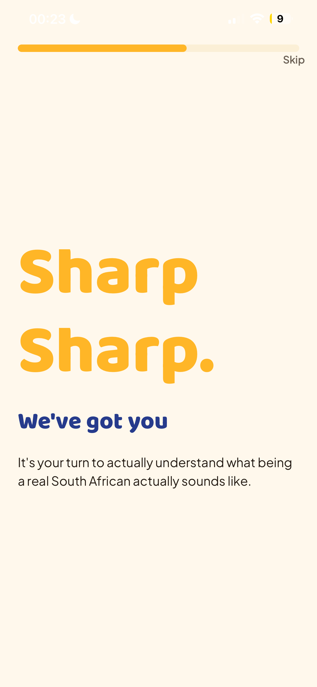</p>

### 2. Meet the app

A short, character-driven onboarding walks new users through what "real" South African slang actually sounds like before they ever see the feed.

<p align="center">
  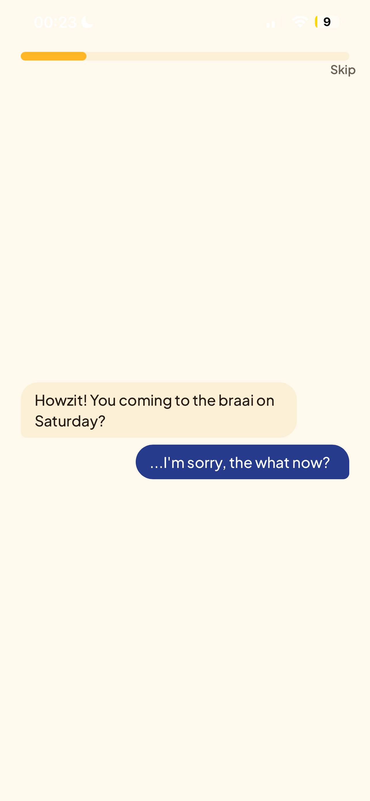
  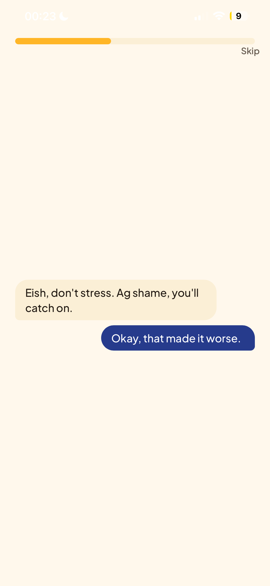
</p>

### 3. Swipe through the feed

Terms appear one at a time as enamel-plaque style cards, colour-coded per term. Swipe right to save a term (and earn XP), swipe left to skip it. Tap a card to flip it and see the full meaning, an example sentence, and who added it.

<p align="center">
  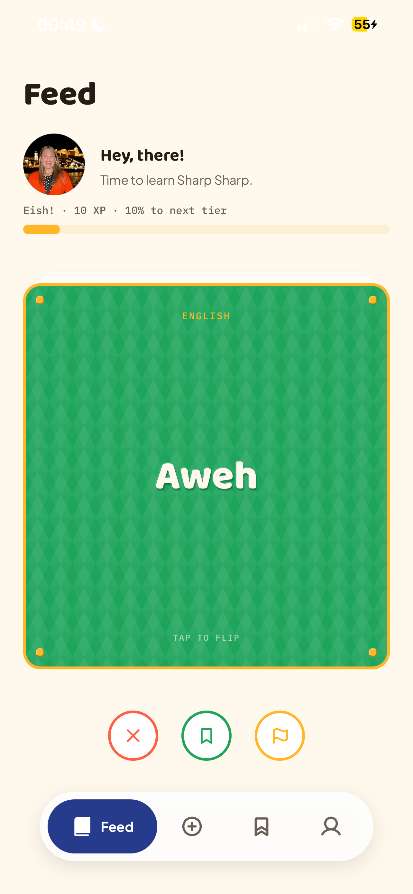
  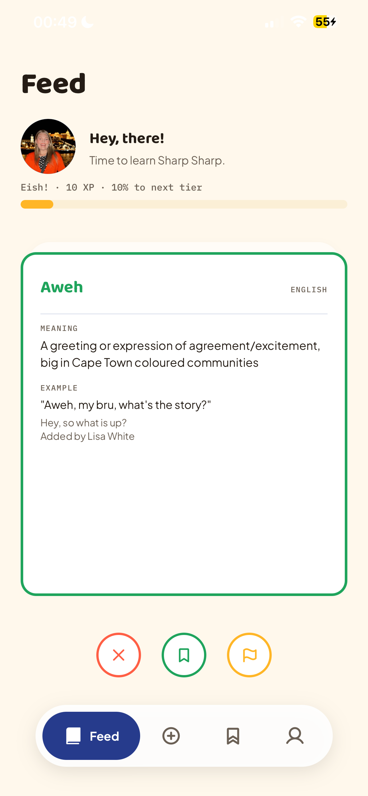
</p>

If a term looks wrong, offensive, or inaccurate, flag it directly from the feed with a reason and an optional comment. It's reviewed by an admin before anything is removed.

<p align="center">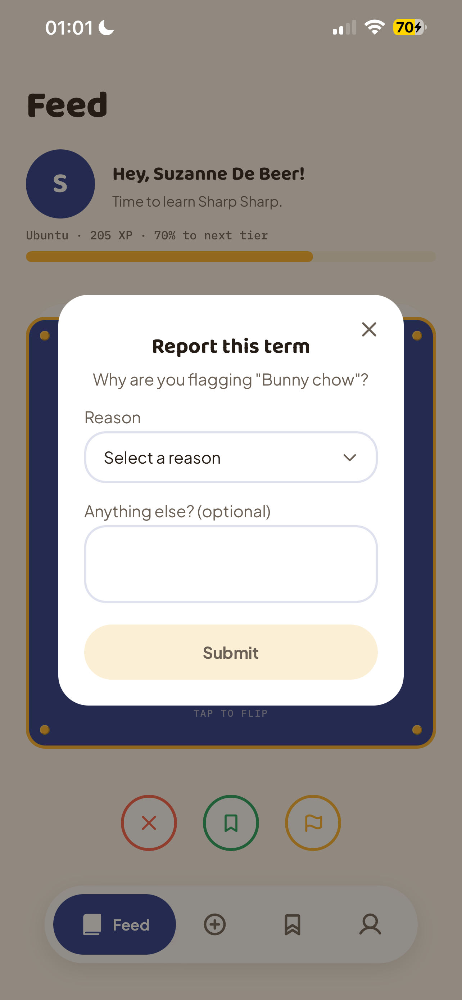</p>

### 4. Add your own words

Know a term that's not in the app yet? Add it in three quick steps: the word itself, what it means in plain language, and which language or dialect it belongs to.

<p align="center">
  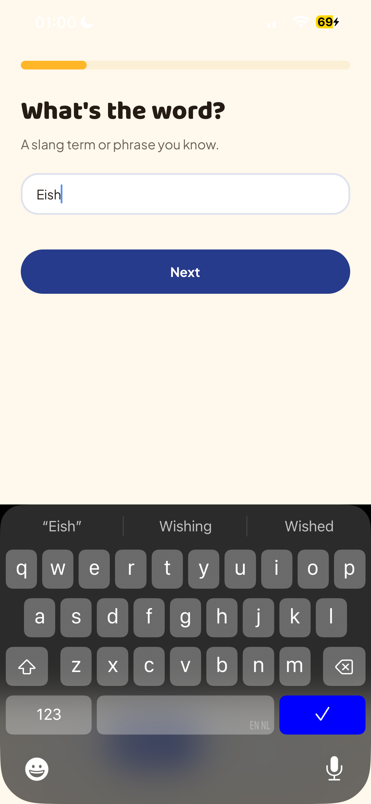
  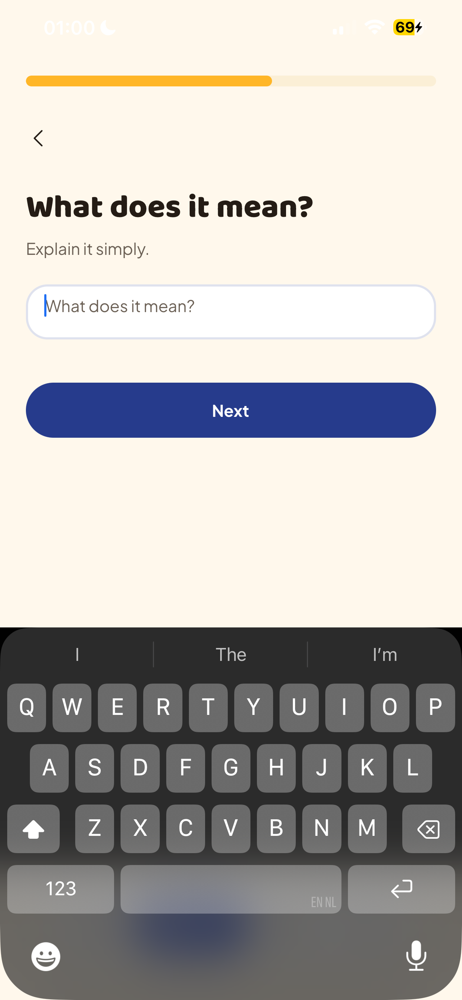
  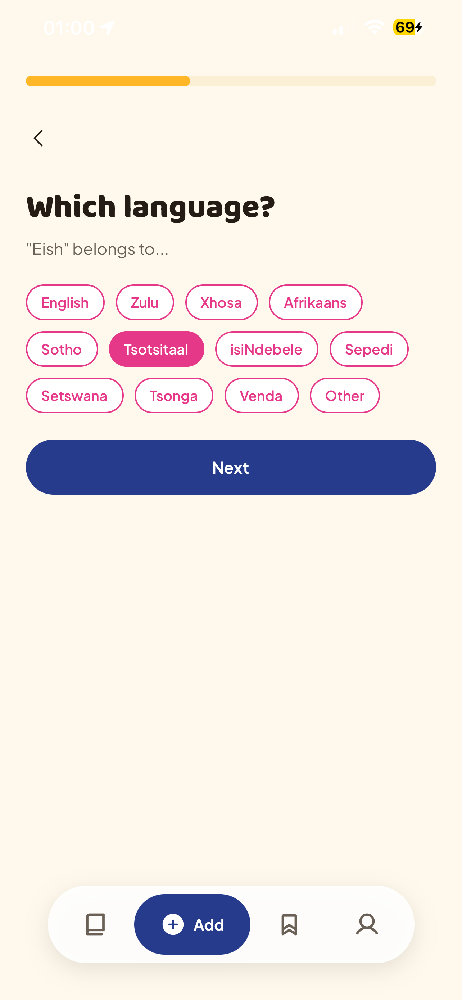
</p>

### 5. Earn XP and level up

Every saved term and every contribution earns XP. As XP builds up, you climb a six-tier ladder named after real South African slang itself: **Eish! → Ubuntu → Lekker → Ayoba → Local Legend → Sharp Sharp**. Your profile shows exactly how much XP each tier needs and what you've unlocked so far.

<p align="center">
  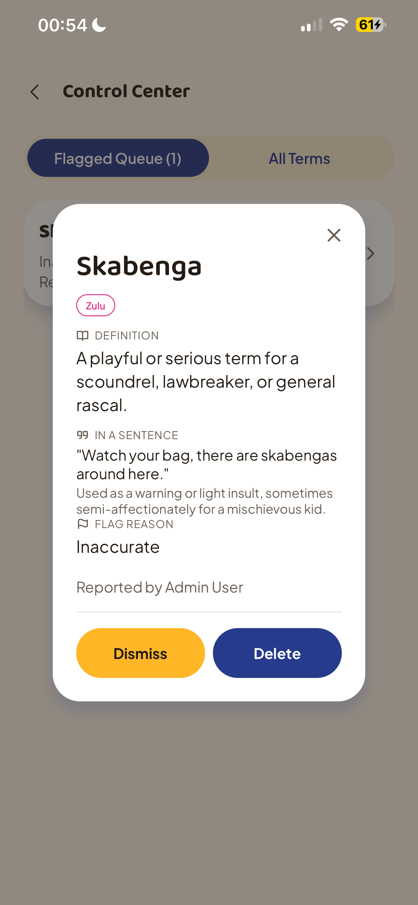
  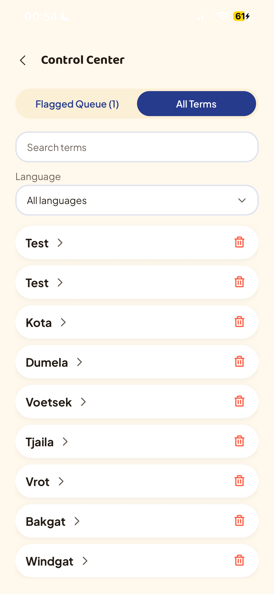
</p>

### 6. Study in Dictionary Mode

Saved terms can be reviewed in a dedicated landscape flashcard mode, an intentional use of Landscape Support: turning the phone sideways switches into a focused, distraction-free study session with larger cards, swipeable navigation, and full definitions on demand.

<p align="center">
  
  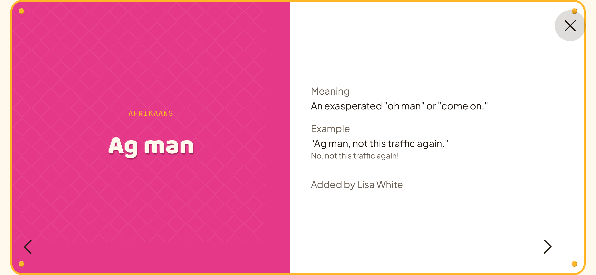
</p>

### 7. Admin controls

A moderation layer sits behind the scenes. Admin accounts can browse every term ever submitted across the app (searchable and filterable by language), and review a dedicated flagged queue where community reports can be inspected in full before being dismissed or deleted.

<p align="center">
  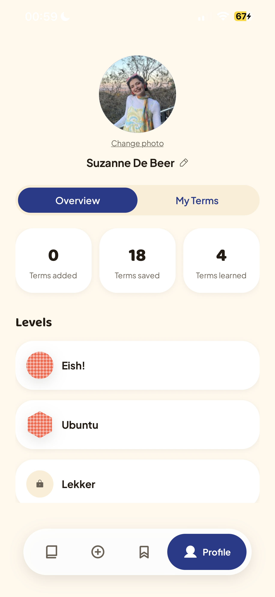
  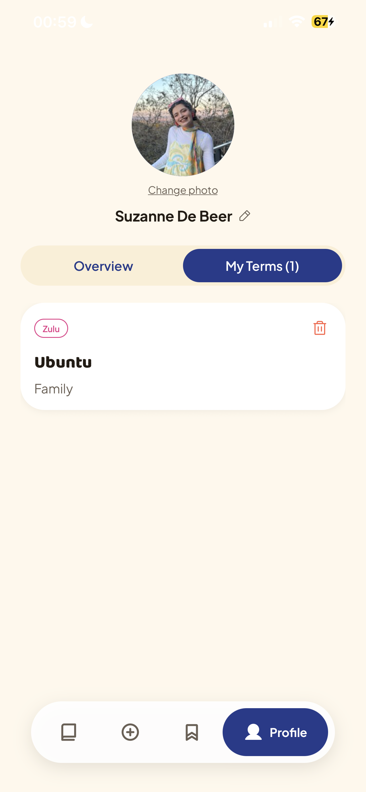
</p>

<p align="center">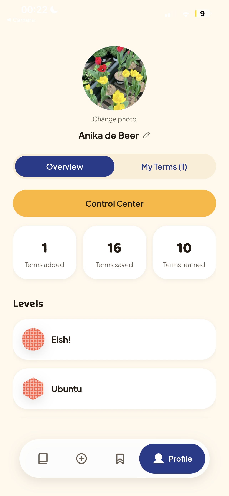</p>

---

## Future iterations

A few features are designed but not yet built, and are honestly flagged here rather than glossed over:

- **Quiz Center** — a level-gated quiz system where certain quizzes unlock as you climb the XP ladder, testing recall of saved terms rather than just recognition.
- **Google Sign-In** — the button exists on the login screen but is disabled pending a development build (Expo Go doesn't support native Google auth).
- **Profile picture via Firebase Storage** — currently profile photos are stored as compressed base64 strings directly in Firestore to avoid requiring a paid Firebase billing plan; migrating to Storage is a possible future improvement.
- **Community guidelines page** — a short explainer on what gets a term flagged, linked from the report modal.

---

## Tech stack

| Layer             | Technology                                                                                                           |
| ----------------- | -------------------------------------------------------------------------------------------------------------------- |
| Frontend          | React Native (TypeScript) via Expo, Expo Router for file-based navigation                                            |
| Backend           | Firebase Authentication (email/password), Firestore (real-time via `onSnapshot`)                                     |
| State & animation | React Context, `react-native-reanimated`                                                                             |
| UI                | Custom design system (`constants/designTheme.ts`), Phosphor Icons                                                    |
| Key libraries     | `react-native-deck-swiper`, `expo-haptics`, `expo-screen-orientation`, `expo-image-picker`, `expo-image-manipulator` |
| Version control   | Git via GitHub Desktop                                                                                               |

---

## Getting started

### Prerequisites

- Node.js and npm
- Expo Go installed on a physical iOS or Android device
- A Firebase project (or use the local emulator suite for development)

### 1. Clone and install

```bash
git clone <this-repo-url>
cd sharp-sharp
npm install
```

### 2. Set up environment variables

Create a `.env` file in the project root with the following variable names. **Never commit this file**, it's already listed in `.gitignore`.

```
EXPO_PUBLIC_FIREBASE_API_KEY=
EXPO_PUBLIC_FIREBASE_AUTH_DOMAIN=
EXPO_PUBLIC_FIREBASE_PROJECT_ID=
EXPO_PUBLIC_FIREBASE_STORAGE_BUCKET=
EXPO_PUBLIC_FIREBASE_MESSAGING_SENDER_ID=
EXPO_PUBLIC_FIREBASE_APP_ID=
```

Fill these in with your own Firebase project's config values, found in the Firebase Console under Project Settings.

### 3. Run the app

```bash
npx expo start
```

Scan the QR code with Expo Go on your physical device. This project is developed and tested exclusively on physical devices via Expo Go, not the iOS Simulator or a web browser.

---

## Test credentials

These accounts exist in the seeded dataset for testing and grading purposes only.

| Role         | Email                   | Password                                |
| ------------ | ----------------------- | --------------------------------------- |
| Regular user | `seed@sharpsharp.local` | `seed@sharpsharp`                       |
| Admin        | `admin@mail.com`        | _(provided separately to the lecturer)_ |

The admin account has an `isAdmin: true` flag on its Firestore user document, which unlocks the Control Center from the Profile screen.

---

## Project structure

```
app/                  Screens (Expo Router file-based routing)
  (tabs)/             Feed, Add, Saved, Profile
  admin/              Control Center (admin-only)
  auth/                Login, Signup
  onboarding/         Onboarding flow
components/ui/        Shared UI components (Button, Card, Text, StudyCard, etc.)
constants/            Design tokens, levels, badges, language list
services/             Firebase read/write logic (slang terms, XP, saved terms)
styles/               Screen-specific stylesheets
types/                TypeScript type definitions
```

---

## Data sources

Seed terms were sourced from real, commonly used South African slang across eight languages and dialects. Where a term's accuracy or community origin couldn't be confidently verified, it was excluded rather than included with a guess, quality over quantity was prioritised throughout.
